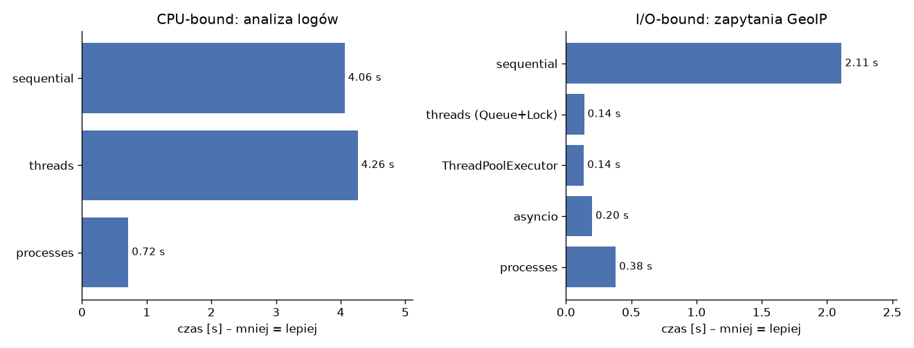

# Analizator logów serwera WWW

Projekt zaliczeniowy z przedmiotu **Zaawansowane techniki programowania w języku Python**.

Program wczytuje duże pliki logów serwera WWW (format Apache/Nginx *combined*) i robi kilka rzeczy:

- czyta je blokami za pomocą własnego iteratora,
- przetwarza je potokiem generatorów,
- wyciąga z każdej linii adres IP, datę, metodę, URL i kod HTTP (wyrażenia regularne z grupami nazwanymi),
- liczy statystyki dla wielu plików naraz (**procesy**),
- sprawdza najaktywniejsze adresy IP w lokalnej bazie GeoIP (**wątki** + `Queue` + `Lock`).

Benchmark porównuje wersję sekwencyjną, wątki, procesy i `asyncio`, żeby pokazać wpływ GIL.

## Wymagania

- Python **3.12+** (testowane na CPython 3.13)
- `pip install -r requirements.txt`: `pytest` (testy) i `matplotlib` (wykres). Sam analizator korzysta tylko z biblioteki standardowej.

## Uruchomienie

```bash
# 1. środowisko (Windows: .venv\Scripts\activate)
python -m venv .venv
source .venv/bin/activate
pip install -r requirements.txt

# 2. dane testowe: 8 plików × 100 000 linii (~110 MB) + baza geoip.json
python -m loganalyzer generate

# 3. analiza (domyślnie procesy) + eksport raportu
python -m loganalyzer analyze --config analyzer.conf --export-json out/report.json --export-csv out/ips.csv
python -m loganalyzer analyze --mode sequential --no-geoip
python -m loganalyzer -v analyze --mode threads           # -v / -vv = więcej logów

# 4. wyszukiwanie wpisów (regex na URL)
python -m loganalyzer search sample_data/access_01.log --status 404 --url-regex "^/api/" --limit 10

# 5. pomiar GIL (wyniki: benchmarks/results.md, .json, .png)
python -m benchmarks.gil_benchmark --repeats 3

# 6. testy
python -m pytest -v
```

**PyCharm:** *Run → Edit Configurations → + → Python*, potem przełączyć *script* na **module**:
- *Module name:* `loganalyzer`
- *Parameters:* np. `analyze --config analyzer.conf`
- *Working directory:* katalog główny projektu

## Struktura projektu

```
log-analyzer/
├── analyzer.conf              # przykładowa konfiguracja (klucz = wartość)
├── loganalyzer/
│   ├── __main__.py            # python -m loganalyzer
│   ├── cli.py                 # argparse: generate / analyze / search / benchmark
│   ├── config.py              # AnalyzerConfig (@property, @classmethod, @staticmethod)
│   ├── report.py              # raport tekstowy, eksport JSON/CSV
│   ├── core/
│   │   ├── patterns.py        # wyrażenia regularne
│   │   ├── reader.py          # ChunkReader – własny iterator
│   │   ├── pipeline.py        # potok generatorów, LogEntry
│   │   ├── stats.py           # LogStats, analyze_file (zadanie CPU-bound)
│   │   └── analyzer.py        # LogAnalyzer – sekwencyjnie / wątki / procesy
│   ├── services/geoip.py      # lokalne GeoIP: wątki + Queue + Lock, pula wątków, asyncio
│   ├── utils/decorators.py    # własne dekoratory
│   └── data/generator.py      # generator danych testowych
├── benchmarks/gil_benchmark.py
└── tests/test_core.py         # 25 testów pytest
```

## Mapowanie zagadnień na kod

| Zagadnienie | Gdzie w kodzie |
|---|---|
| Dekorator funkcji (bez parametrów) | `utils/decorators.py` → `measure_time` (+ `functools.wraps`) |
| Dekorator z parametrami | `utils/decorators.py` → `retry(attempts, delay, exceptions)`, `log_call(level)` |
| Użycie dekoratorów | `services/geoip.py` → `GeoIPDatabase.query` (`@retry`), `core/analyzer.py` → `LogAnalyzer.analyze` (`@measure_time`), `resolve_top_ips` (`@log_call`) |
| Dekorator metody korzystający z `self` | `utils/decorators.py` → `requires_config`, użyty w `core/analyzer.py` → `LogAnalyzer.analyze`, `LogAnalyzer.resolve_top_ips` |
| `@property` z setterem | `config.py` → `AnalyzerConfig.workers`, `chunk_size`, `lookup_delay` (walidacja) |
| `@property` (tylko odczyt) | `core/stats.py` → `LogStats.error_rate`, `LogStats.unique_ips` |
| `@classmethod` | `config.py` → `AnalyzerConfig.from_file`, `from_directory`; `core/stats.py` → `LogStats.combine` |
| `@staticmethod` | `config.py` → `AnalyzerConfig.default_workers` |
| Iterator (`__iter__`, `__next__`) | `core/reader.py` → klasa `ChunkReader` (czyta blokami, skleja linie przecięte granicą bloku) |
| Generator (`yield`) | `core/pipeline.py` → `read_lines`, `parse_lines`, `unique_ips`; `data/generator.py` → `log_line_stream` (nieskończony) |
| `yield from` | `core/pipeline.py` → `read_lines` (deleguje do `ChunkReader`) |
| Wyrażenia generujące | `core/pipeline.py` → `skip_blank`, `filter_entries`; `data/generator.py` → `generate_dataset` |
| Potok generatorów | `core/stats.py` → `analyze_file`: `read_lines → skip_blank → parse_lines` |
| Regex – ekstrakcja (grupy nazwane) | `core/patterns.py` → `LOG_LINE_RE`, `DATE_RE`, `CONFIG_LINE_RE` |
| Regex – walidacja | `core/patterns.py` → `IP_RE` (`is_valid_ip`, `is_private_ip`); filtrowanie URL w `filter_entries` |
| Wątki + synchronizacja | `services/geoip.py` → `IpLookupService.lookup_threads` (`threading.Thread` + `queue.Queue` + `threading.Lock`), `lookup_pool` (`ThreadPoolExecutor`); `cli.py` → równoległy eksport JSON/CSV |
| Procesy | `core/analyzer.py` → `LogAnalyzer.analyze(mode="processes")` (`ProcessPoolExecutor`) |
| Pomiar GIL | `benchmarks/gil_benchmark.py` |
| *Dodatkowo:* testy, CLI, logging, asyncio, wykres | `tests/test_core.py`, `cli.py`, moduł `logging` we wszystkich modułach, `GeoIPDatabase.query_async` / `lookup_async`, `benchmarks/results.png` |

## Wyniki pomiarów

Pomiar: `python -m benchmarks.gil_benchmark --repeats 3` na danych z `generate` (8 plików, 800 000 linii).
Zadanie I/O to 200 zapytań GeoIP po 10 ms (opóźnienie symulowane przez `time.sleep`).

- **Python:** CPython 3.13.7 (GIL włączony)
- **System:** Windows 10
- **Rdzenie CPU:** 24
- **Workers (CPU / I/O):** 8 / 16

| Obciążenie | Wariant | Najlepszy czas [s] | Mediana [s] | Przyspieszenie |
|---|---|---:|---:|---:|
| CPU | sequential | 4.061 | 4.075 | 1.00× |
| CPU | threads | 4.264 | 4.275 | 0.95× |
| CPU | processes | 0.716 | 0.718 | 5.67× |
| I/O | sequential | 2.112 | 2.114 | 1.00× |
| I/O | threads (Queue+Lock) | 0.140 | 0.142 | 15.13× |
| I/O | ThreadPoolExecutor | 0.138 | 0.138 | 15.36× |
| I/O | asyncio | 0.201 | 0.202 | 10.52× |
| I/O | processes | 0.381 | 0.396 | 5.54× |



### Wnioski dotyczące GIL

Przy zadaniu CPU-bound (regex i parsowanie dat w czystym Pythonie) wątki nie dały żadnego przyspieszenia, a były nawet trochę wolniejsze od wersji sekwencyjnej (0,95×). Powodem jest GIL: w danej chwili bajtkod Pythona wykonuje tylko jeden wątek, a pozostałe czekają na blokadę, więc przełączanie wątków jest czystym narzutem. Procesy mają osobne interpretery i osobne GIL-e, więc 8 procesów (8 plików, `default_workers` ogranicza liczbę workerów do 8 mimo 24 rdzeni) przyspieszyło analizę 5,67×. Wynik jest daleki od teoretycznych 8×, bo na Windows procesy uruchamiane są metodą `spawn` (każdy od nowa ładuje interpreter i moduły), a wyniki (`LogStats`) trzeba przesłać między procesami przez `pickle`. Przy zadaniu I/O-bound jest odwrotnie: wątek czekający na sieć lub dysk (tu `time.sleep`) zwalnia GIL, więc 16 wątków przyspieszyło pracę około 15 razy (teoretycznie 16×). To przyspieszenie nie wynika z liczby rdzeni, tylko z tego, że wątki czekają równocześnie. `asyncio` w jednym wątku i bez blokad osiągnął 10,52×, czyli mniej niż wątki. Najpewniej to efekt rozdzielczości zegara pętli zdarzeń na Windows (ok. 15,6 ms): `asyncio.sleep(0.01)` trwa w praktyce ok. 15,6 ms, a 13 rund po 16 zapytań × 15,6 ms ≈ 0,20 s, co zgadza się z pomiarem. Procesy przy I/O też działają (5,54×), ale są najwolniejsze z wariantów współbieżnych, bo uruchomienie 16 interpreterów metodą `spawn` kosztuje więcej niż samo czekanie. Wniosek praktyczny: do zadań I/O wątki lub `asyncio`, do obliczeń w czystym Pythonie procesy. Na free-threaded Pythonie (3.13t/3.14t, `sys._is_gil_enabled() == False`) wątki powinny przyspieszać także zadanie CPU-bound. Benchmark wypisuje stan GIL, więc można to sprawdzić tym samym skryptem.

> Wyniki zależą od komputera: liczby rdzeni, dysku i systemu. Powyższy pomiar pochodzi z Windows, gdzie procesy startują metodą `spawn`. Na Linuksie (`fork`/`forkserver`) uruchamianie procesów jest zwykle tańsze, więc przyspieszenie wariantu `processes` może być większe.

## Problemy napotkane w trakcie realizacji

1. **Linie przecięte granicą bloku.** `ChunkReader` czyta plik po N bajtów, więc linia może zacząć się w jednym bloku i skończyć w następnym. Rozwiązanie: ostatni (niepełny) fragment bloku jest zapamiętywany i doklejany na początek kolejnego. Testy sprawdzają to przy blokach 1, 7, 64 i 4096 bajtów.
2. **Kolejność dekoratorów.** `@measure_time` zapisuje czas w atrybucie wrappera. Gdy był pod `@requires_config`, zewnętrzny wrapper miał tylko kopię tego atrybutu z chwili dekorowania (`functools.wraps` kopiuje `__dict__`), więc zawsze odczytywał 0. Pomogło zamienienie kolejności.
3. **Procesy wymagają serializacji.** Do `ProcessPoolExecutor` można przekazać tylko obiekty, które da się zapisać przez `pickle`, dlatego `analyze_file` jest funkcją na poziomie modułu, a nie lambdą ani funkcją zagnieżdżoną. Na Windows potrzebny jest też strażnik `if __name__ == "__main__"` (jest w `__main__.py`).
4. **Uczciwy pomiar I/O.** Przy 2 wątkach (tyle, ile rdzeni) różnica między wątkami a procesami przy I/O była niewidoczna. Liczba workerów dla I/O nie musi zależeć od liczby rdzeni, więc benchmark ma osobny parametr `--io-workers` (domyślnie 16).
5. **Prawdziwe API GeoIP** ma limity zapytań i wymaga internetu, przez co demo byłoby zawodne. Zastąpiła je lokalna baza JSON z symulowanym opóźnieniem i losowymi błędami (`fail_rate`), które obsługuje dekorator `@retry`.
